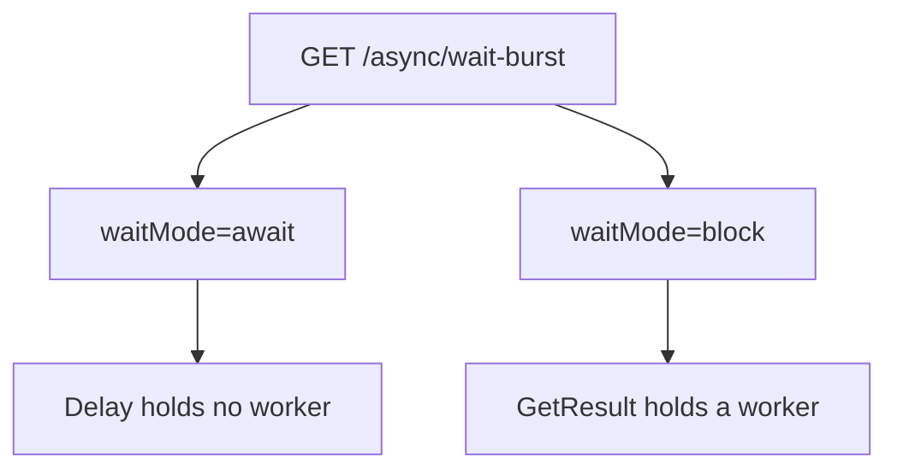

# lab-csharp-async-memory

ASP.NET Core API that shows a wait which holds a worker, a token the handler actually reads, a buffer the request forgets to dispose, and two ways to build the same string.

.NET 10. HTTP on port **5055**. Swagger UI in Development: [http://localhost:5055/swagger](http://localhost:5055/swagger).

The burst runs on a lab pool of **two workers**. That cap is what makes the blocking path slower on a laptop. Do not copy `waitMode=block` into a real API.

## Run

```powershell
dotnet run --project src/LabCsharpAsyncMemory.Api
dotnet test
```

Open `LabCsharpAsyncMemory.slnx` and start the `http` profile. The OpenAPI document is `/openapi/v1.json`. Swagger is not registered outside Development.

## Async



Each wait is 150 milliseconds. `waitCount=16`.

| waitMode | pattern | What the numbers show |
| --- | --- | --- |
| `await` | `await` | `peakThreads` stays at 0. `elapsedMs` stays near one delay. |
| `block` | `GetResult` | `peakThreads` reaches the pool cap of 2. `elapsedMs` is several times longer, because 16 waits share 2 workers. |

`GET /async/cancellable-wait?durationMs=4000&cancelAfterMs=200` checks the token between steps. `completed` is false, `cancelled` is true, and `elapsedMs` stays well under 4000. Without `cancelAfterMs`, `GET /async/cancellable-wait?durationMs=400` finishes and `completed` is true. Accepting the token and never reading it would not stop the loop.

A query outside the allowed range is 400. The body names the parameter and the range. `durationMs=0` says it must be from 1 to 10000. `cancelAfterMs=0` says the same for the cancel delay. `waitMode=spin` says the value must be `await` or `block`.

## Memory

| Path | What it does |
| --- | --- |
| `GET /memory/scoped-buffer` | Creates a scoped buffer and disposes it with the scope. A second call reports the same `liveBuffers`. |
| `GET /memory/orphaned-buffer` | Creates a buffer and does not dispose it. `liveBuffers` rises by one. The status is still 200. |
| `GET /memory/string-concat?partCount=2000` | Appends into a new string each time. `length` is 2000. `allocatedBytes` is the expensive one. |
| `GET /memory/string-builder?partCount=2000` | Builds the same length with a `StringBuilder`. |

## Endpoints

| Method | Path | Result |
| --- | --- | --- |
| GET | `/health` | 200 liveness. |
| GET | `/async/wait-burst?waitMode=&waitCount=` | Await or blocking burst. 400 when `waitMode` is not `await` or `block`, or `waitCount` is outside 1–32. |
| GET | `/async/cancellable-wait?durationMs=&cancelAfterMs=` | Completed or cancelled wait. `durationMs` is required, 1–10000. `cancelAfterMs` is optional, 1–10000. |
| GET | `/memory/scoped-buffer` | Live buffers after the scope disposes. |
| GET | `/memory/orphaned-buffer` | Live buffers after a skipped dispose. |
| GET | `/memory/string-concat?partCount=` | Allocations for repeated string append. 400 when `partCount` is outside 1–5000. |
| GET | `/memory/string-builder?partCount=` | Allocations for the builder. Same `partCount` rule. |

---

I hope the counters in this repository help you see which wait kept a worker, and which request returned 200 without giving its objects back.

Sevann Radhak
